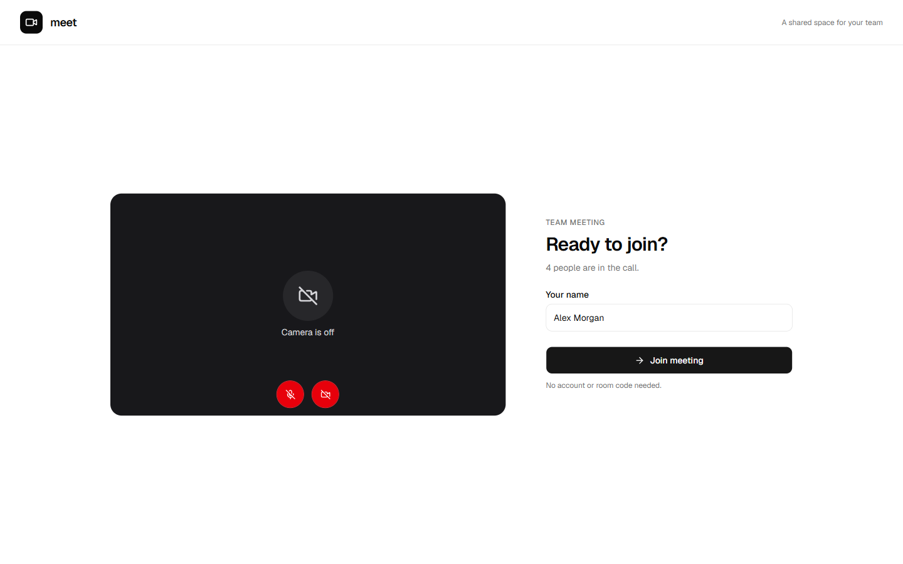
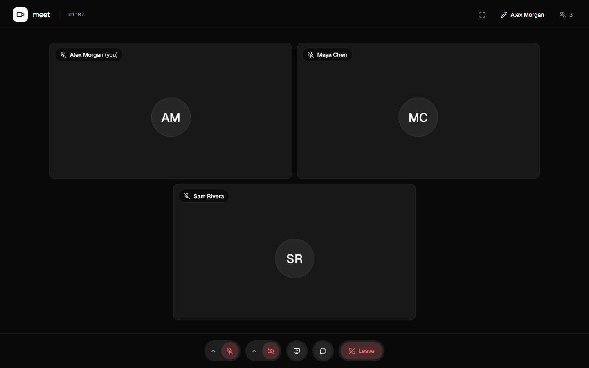
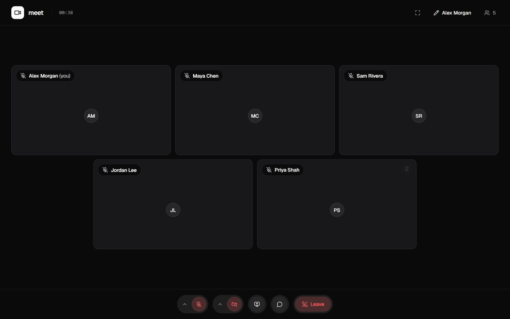
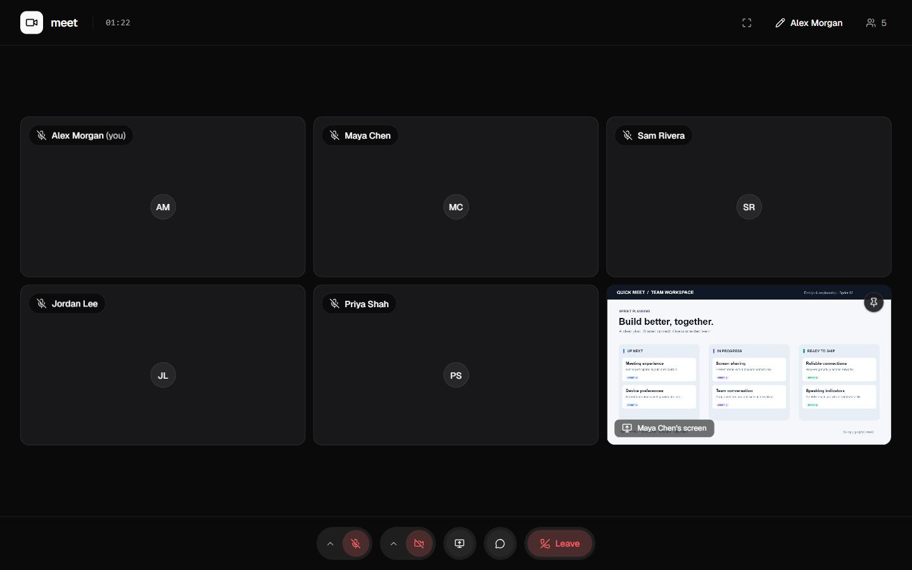
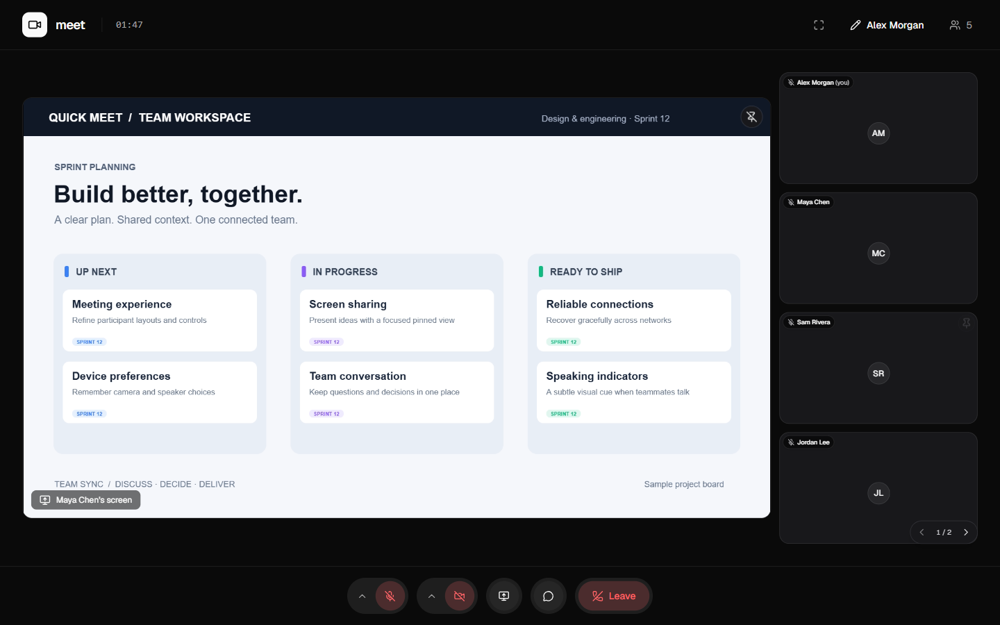
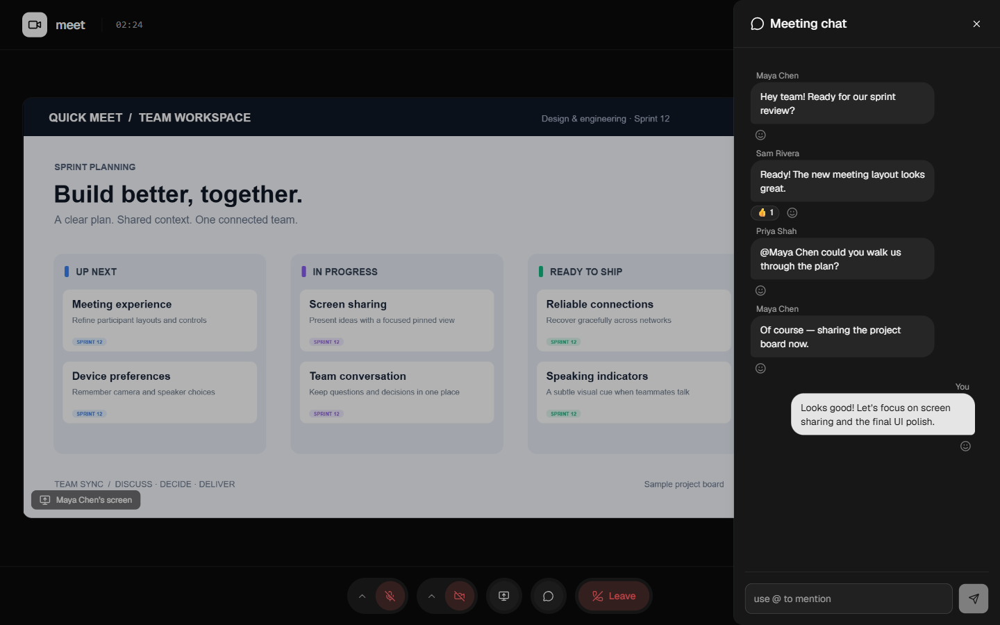

# Quick Meet

Quick Meet is a small browser-based video meeting app for teams. Open the app, check your camera and microphone, and join a shared meeting—no account or room code required.

Each meeting supports up to five participants. Audio and video use direct WebRTC peer connections. The Node.js API manages participant presence and WebRTC signaling over native WebSockets.

## Features

- Camera and microphone preview before joining.
- Microphone and camera controls.
- Live participant tiles with speaking indicators.
- Editable display name and remembered media preferences.
- Responsive layout for desktop and mobile.
- Leave and rejoin support.

## Preview

Desktop screenshots at 1440 × 900, using sample participants, messages, and shared content.

### Before you join

Check your camera and microphone, set your display name, and join the call.



### Three-person meeting



### Five-person meeting



### Screen sharing

Share a screen alongside the participant gallery.



### Pinned shared screen

Pin a presentation to focus on it while keeping participants in the sidebar.



### Meeting chat

Send messages, mention teammates, and react without leaving the call.



## Tech stack

- React, Vite, TanStack Router/Query/Form, Tailwind CSS, and shadcn/ui.
- Hono and tRPC on Node.js.
- Native WebSockets for presence and signaling.
- WebRTC mesh connections for audio and video.
- pnpm, TypeScript, Biome, and Vitest.

## TURN server

WebRTC connects directly when possible. A TURN server is required as a relay for restrictive networks that cannot establish a direct connection. This project uses coturn and short-lived credentials generated by the API.

Configure the API with:

```env
TURN_SERVER_URLS=turn:turn.example.com:3478?transport=udp,turn:turn.example.com:3478?transport=tcp
TURN_SHARED_SECRET=your-coturn-shared-secret
```

The coturn server must use the same shared secret and expose port `3478` plus its configured relay port range over TCP/UDP. If using Cloudflare DNS, the TURN hostname must be DNS-only; Cloudflare Tunnel is not a replacement for a public TURN endpoint.

## Local setup

### Requirements

- Node.js 24.15 or newer on the 24.x line.
- pnpm 11.15.1.

### Install

From the repository root:

```bash
pnpm install --frozen-lockfile
```

### Configure the web app

Create `apps/web/.env.local`:

```env
VITE_SERVER_URL=http://localhost:8787
```

### Run locally

```bash
pnpm dev
```

Open `http://localhost:5173` and allow camera and microphone access when prompted. The API runs at `http://localhost:8787`.

Camera and microphone access require HTTPS or localhost. To test a call, open the app in a second browser profile or device.

## Useful commands

```bash
pnpm check-types
pnpm test
pnpm lint
pnpm build
```
